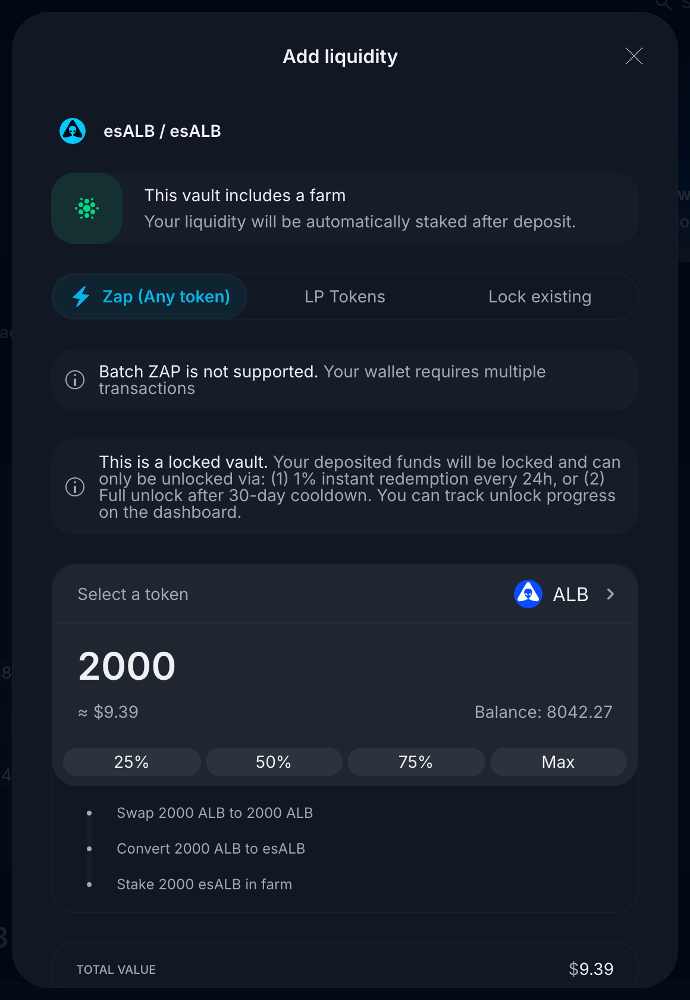
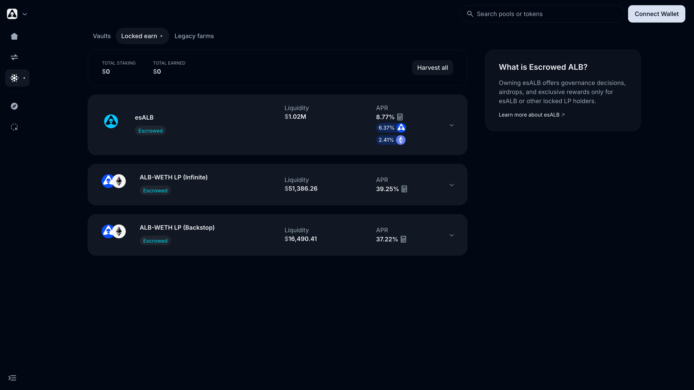
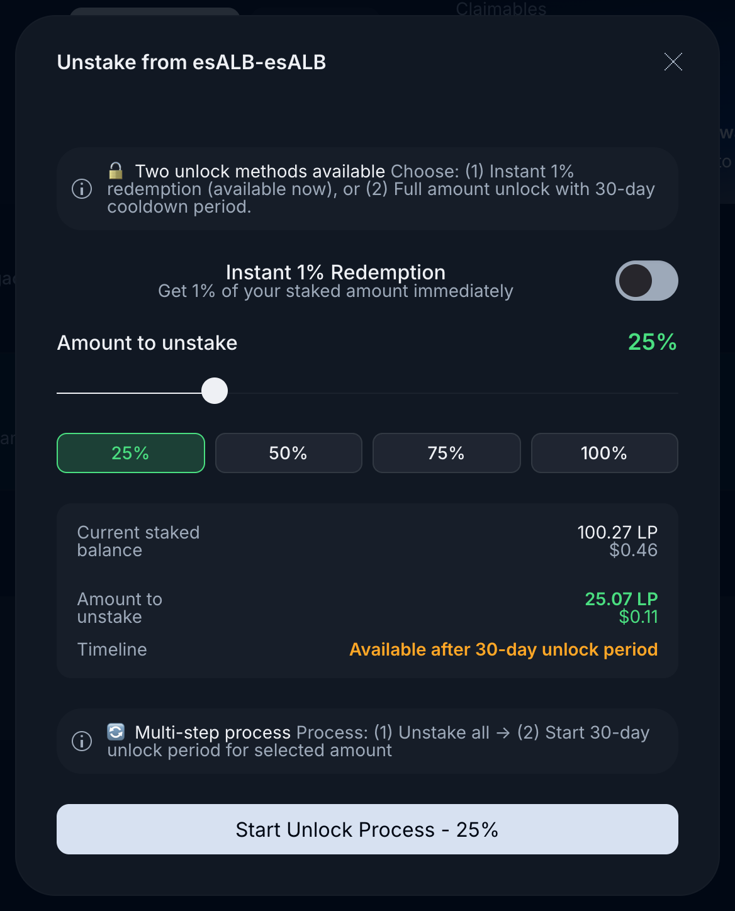

# Escrowed ALB (esALB)

**esALB** is the locked form of ALB. It earns a share of protocol rewards (ALB and **WETH Real Yield**) and carries governance voting power. If you plan to hold ALB long-term, you almost certainly want it as esALB, or as [govALB](#govalb) if you want maximum voting power.

> _Last updated: October 22, 2026._


**esALB moved to a new contract with Alien Base 2.0.** Old esALB (`0x365c…4113`) migrates **1:1** into new esALB, which starts earning right away. Use the [Migration Guide](../migration/README.md). The rules for the old token are kept at the [bottom of this page](#legacy-esalb-pre-migration).


## In one paragraph

Lock ALB → esALB **1:1**. As long as esALB sits in your wallet it earns ALB and WETH rewards automatically, with no staking step. esALB can't be traded or sent to other wallets. To get back to ALB, start an unstake: after **30 days** you can redeem **85%**, rising linearly to **100% at 60 days**, and 70% of the position keeps earning while it vests. You also get a small **instant redemption allowance** of 2% of your position every 48 hours, at 1:1. For 10× voting power, convert esALB into [govALB](#govalb).

## At a glance

|                        |                                                                                                                       |
| ---------------------- | --------------------------------------------------------------------------------------------------------------------- |
| esALB token            | [`0x32d9f29170a023794025375df6949f56844e4473`](https://basescan.org/token/0x32d9f29170a023794025375df6949f56844e4473) |
| Name / symbol          | Escrowed Alien Base Token / esALB (18 decimals)                                                                        |
| Backing                | 1 esALB = 1 new ALB held by the esALB contract                                                                         |
| Transferable?          | No. Transfers only work to or from protocol contracts (e.g. the staking contract)                                      |
| Earning                | Automatic while held: ALB + WETH from the [staking contract](../contracts.md#new-token-system-aip-5)          |
| Standard exit          | 30 days → 85%, linear to 100% at 60 days. Unredeemed share goes to stakers                                             |
| Earning while exiting  | 70% of the vesting amount keeps earning                                                                                |
| Instant exit           | 2% of your position per 48-hour window, 1:1, no penalty                                                                |
| Voting weight          | 1× per esALB (govALB: 10×)                                                                                             |
| Legacy esALB           | [`0x365c6d58…4113`](https://basescan.org/token/0x365c6d588e8611125de3bea5b9280c304fa54113): [migrate 1:1](../migration/README.md) |

## What esALB is for

* **Rewards.** esALB and govALB holders share the staking contract's reward streams, currently **ALB** and **WETH**, in proportion to their balance. Every esALB earns the same rate whether you hold 10 or 10 million.
* **Real Yield.** Protocol fees are paid out in **WETH** and other liquid assets, not in extra ALB inflation. Details: [Real Yield](real-yield.md).
* **Line of Credit interest.** Under AIP-5, interest on the Dev Line of Credit is paid to esALB holders. See [Alien Labs](../alien-base-dao/alien-labs.md).
* **Governance.** Voting power on Snapshot is weighted by esALB (and 10× for govALB). See [Alien Base DAO](../alien-base-dao/).
* **Exit penalties go to holders.** When someone redeems early (before day 60), the part they leave behind is paid out to esALB and govALB holders as ALB rewards.

## Getting esALB

* **Migrating old esALB:** run the [migration](../migration/README.md). You receive new esALB 1:1 and it starts earning immediately.
* **Locking new ALB:** use **Lock & Earn** in the [app](https://app.alienbase.xyz/dashboard), or on Basescan approve ALB for the esALB contract and call `depositFor(yourAddress, amount)` on [esALB](https://basescan.org/token/0x32d9f29170a023794025375df6949f56844e4473#writeContract). You receive 1 esALB per ALB.

To see esALB in your wallet, add [`0x32d9f29170a023794025375df6949f56844e4473`](https://basescan.org/token/0x32d9f29170a023794025375df6949f56844e4473) as a custom token.

## Earning

There is nothing to stake or enable. The esALB contract reports every balance change to the staking contract, so your share updates the moment you lock, migrate, unstake or redeem. Rewards accrue continuously and can be claimed at any time from the app (or by calling `claim` on the staking contract with the reward tokens you want).

## Redeeming esALB back to ALB

You have two exits, and you can use both at once.

### Standard unstake (30 to 60 days)

1. **Start an unstake** for any amount (`startUnstake`). That esALB moves into a vesting position.
2. **While it vests**, 70% of the amount keeps earning rewards. The other 30% stops.
3. **From day 30** you can finalize (`finalizeUnstake`). The payout grows linearly with time:

| Finalize after | You receive |
| -------------- | ----------- |
| < 30 days      | Not possible yet |
| 30 days        | 85% |
| 45 days        | 92.5% |
| 60+ days       | 100% |

4. **The rest is not burned.** Whatever you leave behind by finalizing early is paid out to esALB and govALB holders as ALB rewards.

There is no redemption window and no auto-relock: a position that reaches 60 days simply waits at 100% until you finalize. You can **cancel** a vesting position at any time (`cancelUnstake`) to get the full esALB back, earning at 100% again. Each unstake is its own position, so you can stagger several.

### Instant redemption (2% every 48 hours)

Every 48-hour window you get an allowance of **2%** of your esALB position (wallet balance plus anything in vesting). Redeem up to that amount instantly at **1:1**, with no penalty (`instantRedeem`). Unused allowance doesn't roll over to the next window.

## govALB

**govALB** ("Governance Alien Base Token") is the long-commitment tier introduced by [AIP-5](../alien-base-2-0.md).

|                   |                                                                                                                       |
| ----------------- | --------------------------------------------------------------------------------------------------------------------- |
| govALB token      | [`0x7fdb2cbe3dd946b6b4521d4a2cce62296ec1441d`](https://basescan.org/token/0x7fdb2cbe3dd946b6b4521d4a2cce62296ec1441d) |
| How to get it     | Convert esALB → govALB 1:1 (`convertTo(govALB, amount)` on esALB). One-way: govALB can't convert back to esALB          |
| Voting weight     | **10×** per govALB                                                                                                    |
| Earning           | **1×**, same rate per token as esALB, from the same staking contract                                                  |
| Standard exit     | 2-year unstake, then 100% back as ALB. Nothing earns while it vests                                                   |
| Instant exit      | 1.436% of your position per 7-day window, 1:1                                                                         |
| Caps              | 30,000,000 govALB total supply; 5,000,000 govALB per wallet                                                           |

govALB is for holders who want maximum say over the protocol's long-term direction and are happy to commit for two years in exchange.

## Legacy esALB (pre-migration)

The rules below apply only to the **old** esALB at [`0x365c6d58…4113`](https://basescan.org/token/0x365c6d588e8611125de3bea5b9280c304fa54113). They're kept for holders who haven't migrated yet. Old esALB is no longer actively supported, so the simplest path is to [migrate](../migration/README.md) it.

In short: old esALB had to be staked in the **Locked earn** vault to earn, and unlocked either 100% after a 30-day cooldown (with a 7-day claim window) or about 1% instantly every 12 hours.

### Locking (legacy)

1. Open the [Dashboard](https://app.alienbase.xyz/dashboard) and click **Lock & Earn** (also available from the **Locked earn** tab on the Vaults page via **Lock & Stake**).
2. Pick the **Escrowed ALB (esALB)** farm. A deposit modal opens.
3. Choose your input: **Zap (any token)**, **LP Tokens**, or **Lock existing** ALB.
4. Enter the amount. The modal previews each step (e.g., swap → convert to esALB → stake in farm).
5. Approve and confirm the transactions (batch zap isn't supported, so expect one transaction per step).

Your deposit is automatically staked in the esALB farm after conversion. You'll receive 1 esALB for every ALB locked. To see the esALB balance in your wallet, add the contract address [`0x365c6d58…4113`](https://basescan.org/address/0x365c6d588e8611125de3bea5b9280c304fa54113) as a custom token.

### Staking (legacy)

After locking, head to the [Vaults](https://app.alienbase.xyz/vaults) page → **Locked earn** tab. The **esALB** position is at the top, next to the escrowed ALB-WETH LP positions (Infinite and Backstop).

1. Click **Enable** to authorize the staking contract to move esALB.
2. Click **Stake** and choose the amount.
3. Rewards (unlocked ALB) accrue continuously. The APR is shown split by source (ALB emissions vs. Real Yield). Click **Harvest** (or **Harvest all**) any time to claim.

Your staked esALB still counts for **governance voting** and **Real Yield**.

### Unlocking (legacy)

Open the **Locked earn** tab on the Dashboard, find your **Escrowed ALB (esALB)** farming position, and click the unstake icon. The unstake modal offers two redemption paths (mixable):

#### Path A — full unlock after a 30-day cooldown, no penalty

1. In the unstake modal, choose the **amount to unstake** (slider or 25/50/75/100% presets), leaving **Instant 1% Redemption** off.
2. Click **Start Unlock Process**. This is a multi-step transaction: unstake, then start the 30-day unlock period for the selected amount.
3. The position moves to **Locked → Vested** on the Dashboard, where you can track unlock progress. While vesting, **you continue to earn rewards at a 30% reduction**.
4. After 30 days, redeem the full amount as ALB.

> You have **7 days** to redeem after vesting completes. If you miss the window, the position re-locks and starts a new 30-day vesting cycle.

#### Path B — 1% instant redemption, every 12 hours

1. In the unstake modal, toggle **Instant 1% Redemption** on.
2. Confirm the transaction. You instantly receive 1% of your staked esALB back as ALB.
3. You can repeat every 12 hours.

The 1% is computed against your **total** esALB position, including any portion currently in 30-day vesting. You can use both paths simultaneously — e.g., put half into 30-day redemption and drip the rest 1% every 12 hours.

### Common pitfalls (legacy)

* **"I don't see my locked esALB on the Dashboard."** It's probably staked in the esALB Single Stake vault. Unstake first; it'll reappear under your portfolio.
* **"My approve transaction succeeded but Lock still says I need to approve."** Likely an allowance-cap quirk on Base. See [Changing allowance](changing-allowance.md).
* **"I missed the 7-day redeem window."** It auto-relocks. Re-trigger redemption to start a fresh 30-day cycle, or use Path B to drip out.
* **"Why is my staking APR lower than expected?"** APR includes the unlocked ALB stream from the vault. The Real Yield (WETH) is shown separately. Total economics is APR + WETH yield + governance optionality.

## Live data

The [Dune dashboard](https://dune.com/sealaunch/alienbase) tracks esALB live:

* **esALB Holders** — current count and growth over time.
* **ALB locked on esALB** and **ALB in esALB** — the supply view.
* **ALB-esALB Lock/Unlock** — daily inflows/outflows between ALB and esALB.
* **Total Holders (ALB + esALB)** — combined holder count, useful for evaluating decentralization.

## See also

* [esLP](eslp.md) — locked LP positions (e.g., ALB-ETH).
* [Vesting](vesting.md) — long-form vesting schedules (team, advisors, contributors).
* [Real Yield (WETH)](real-yield.md) — the protocol-fee distribution mechanism.
* [Changing allowance](changing-allowance.md) — legacy esALB allowance fix.
* [Migration Guide](../migration/README.md) — move old esALB to the new contract.
* [Data & Analytics](../data-and-analytics.md) — full data-source map.
* [Introducing EsALB: The Next Phase of Alien Base Tokenomics](https://medium.com/@alienbase/introducing-esalb-the-next-phase-of-alien-base-tokenomics-e5bfa049486f) — original launch article.
